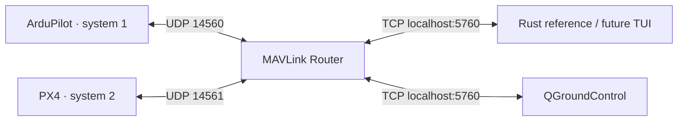

# mav-tui

Rust TUI scaffold with a reusable MAVLink client and headless quadcopter SITL.
The simulator setup supports Ubuntu 24.04 x86_64 with Docker Engine and Compose.
Run one autopilot at a time at real-time speed.

## Start a simulator

```sh
scripts/sitl up ardupilot
# Or switch to PX4 (stops ArduPilot and restarts the router):
scripts/sitl up px4

scripts/sitl logs                 # Ctrl-C stops following logs
scripts/sitl logs px4
scripts/sitl down                 # Preserve parameters, missions, and logs
scripts/sitl reset px4            # Explicitly erase ONLY PX4's state and logs
```

The first `up` builds firmware and recursive submodules from official release
tags. This can take several minutes and several GB of Docker build cache. Later
starts use compiled images and need no downloads or compilation. `up` builds
missing images before stopping the previous simulator, then restarts routing to clear learned
vehicle associations. Wait for GPS/EKF initialization before starting a mission.
After resetting a simulator, run `up` again. Resetting leaves the other simulator's
state intact. Do not use `docker compose down -v` if you want to keep either state.
After changing files under `docker/`, rebuild explicitly with
`scripts/sitl build ardupilot` or `scripts/sitl build px4`, then run `up`. Builds also accept the
Dockerfiles' `BUILD_JOBS` argument through `docker compose build --build-arg`.

| Component | Pinned version | Role |
| --- | --- | --- |
| [ArduCopter](https://github.com/ArduPilot/ardupilot/releases/tag/Copter-4.7.2) | Copter-4.7.2 | Built-in quadcopter physics, system 1 |
| [PX4](https://github.com/PX4/PX4-Autopilot/releases/tag/v1.17.0) | v1.17.0 | `sihsim_quadx`, system 2 |
| [MAVLink Router](https://github.com/mavlink-router/mavlink-router/releases/tag/v4) | v4 + local TCP fix | Separate UDP inputs, shared TCP server |
| [QGroundControl](https://github.com/mavlink/qgroundcontrol/releases/tag/v5.1.5) | v5.1.5 | Ground station and mission execution |
| [Rust MAVLink](https://docs.rs/crate/mavlink/0.19.1) | 0.19.1 | Tokio TCP/UDP, common + ArduPilot dialects, MAVLink 2 extensions |

Pins were checked on 24 October 2026. Build-tool and Ubuntu package updates are
resolved at image build time; these are source-version pins, not bit-for-bit image
reproducibility. `docker/` contains all image sources and simulator defaults.

`docker/router/tcp-send.patch` fixes v4's TCP writes: its IPv6 listener accepts
peers into an IPv4-sized address buffer, then `sendto()` fails with `EINVAL`.
The patch uses `send(..., MSG_NOSIGNAL)` on the already-connected socket, without
passing the truncated address. The source tag and recursive submodules stay at v4.



Each host client opens its own TCP connection to `127.0.0.1:5760`. Only the
router's TCP listener is published, bound to host loopback. Simulator UDP traffic
stays on the Compose bridge. Each simulator resolves `router` at startup, then
sends MAVLink 2 directly to its dedicated UDP server endpoint. A Router UDP
server tracks one remote IP/port, so the inputs must remain separate for future
mixed fleets. See [Router routing behavior](https://github.com/mavlink-router/mavlink-router/tree/v4#detailed-description-of-capabilities).

ArduPilot uses `MAV_SYSID=1` (the 4.7 parameter name); PX4 uses instance 1 and
`MAV_SYS_ID=2`. PX4's stock startup sets its ID from the instance number after
environment parameter overrides. PX4's custom MAVLink startup replaces its
default localhost/broadcast links with a single router link. Separate named
volumes store `/state` for each autopilot, including ArduPilot `logs/` and PX4
`log/` and parameter/mission files. To inspect them:

```sh
docker compose --profile ardupilot exec ardupilot ls -la /state
docker compose --profile px4 exec px4 ls -la /state
```

## QGroundControl

```sh
scripts/qgc install
scripts/qgc run
# Only if Ubuntu runtime libraries are missing (uses sudo):
scripts/qgc deps
```

The installer downloads the official x86_64 AppImage into ignored `.tools/qgc`
and verifies SHA-256 against the [published v5.1.5 asset digest](https://github.com/mavlink/qgroundcontrol/releases/expanded_assets/v5.1.5).
`run` verifies it again. Additional arguments are passed to the AppImage.
If FUSE mounting is unavailable, `scripts/qgc run --appimage-extract-and-run`
is supported by the AppImage runtime.

In QGC, open **Application Settings → Comm Links → Add**:

1. Name: `Docker SITL`; type: **TCP**.
2. Host/server: `127.0.0.1`; port: `5760`.
3. Enable **Automatically Connect on Start**, save, select the link, and
   **Connect**. The saved link will connect automatically on later launches.

See [QGC communication links](https://docs.qgroundcontrol.com/master/en/qgc-user-guide/settings_view/comm_links.html).
Default UDP auto-connect cannot reach the bridge-only simulators. After switching
autopilots, reconnect this TCP link if QGC does not reconnect automatically. Keep
QGC's default system ID 255; the Rust client defaults to 250:190.

## Fly the square mission

Both simulators start at **47.397742, 8.545594, 488 m AMSL**, heading north.
The two fixtures differ in firmware metadata (ArduPilot 3, PX4 12); both declare
a quadrotor and relative-to-home altitudes. They take off to **10 m above home**
(about 498 m AMSL), fly north/east/south/west around a **20 m square**, return to
the takeoff coordinates, and land there. Waypoints use WGS84 local offsets.

1. Start the chosen simulator and connect QGC. Wait for parameter download,
   GPS fix, home position, and estimator/preflight readiness.
2. Open **Plan → File → Open**, then choose
   `missions/ardupilot-square.plan` or `missions/px4-square.plan` to match it.
   Confirm the home location, 10 m altitude, and square on the map.
3. **Upload** the mission. Switch to **Fly** and use QGC's **Start Mission**
   action, then confirm its arming/start prompts. ArduPilot's defaults permit
   arming and takeoff in AUTO without moving a transmitter throttle stick.
4. Observe the vehicle position, relative altitude, active/reached mission item,
   and landing in QGC. Run the Rust watch example alongside it to see the same
   telemetry, armed state, mission sequence, and landed state.
5. Confirm the aircraft returns to the start, descends, lands, and disarms before
   switching autopilots. Repeat using the other fixture.

The simulator defaults permit autonomous operation without RC input. GPS,
estimator, and ordinary pre-arm checks remain enabled. Rust smoke checks request
firmware and telemetry only; mission upload and execution belong to QGC.

## Terminal display

Start one simulator, then run `cargo run`. The display discovers the autopilot,
requests local-position telemetry at 5 Hz, and plots the latest 30 seconds of
local altitude beside the north/east track. Altitude is in metres above the
estimator's local origin (`-z` in the NED frame); it is not necessarily height
above home. The chart scales automatically and waits for local-position samples
before drawing. Press Esc, q, or Q to exit.

## Rust reference

```sh
cargo run --example mavlink_smoke
cargo run --example mavlink_smoke -- --watch
cargo run --example mavlink_smoke -- --target-system 2
cargo run --example mavlink_smoke -- --endpoint tcpout:127.0.0.1:5760 --client-system 249
```

The default endpoint is `tcpout:127.0.0.1:5760`. TCP client, UDP client, and UDP
listener endpoints are supported (`tcpout:`, `udpout:`, `udpin:`). See `--help`
for identity, targeting, and discovery-window overrides. Separate simultaneous
Rust clients must use distinct identities.

[`src/mav.rs`](src/mav.rs) is independent of the TUI. `ConnectionConfig` supplies
the endpoint, client identity, and connect/discovery/request/idle deadlines.
`Connection` owns one receive loop and a 1 Hz GCS heartbeat; `subscribe()` gives
each consumer its own decoded `TelemetryEvent` stream with the full `VehicleId`.
`discover()` observes the entire discovery window, ignores GCS/non-autopilot
heartbeats, and records the heartbeat autopilot type. `select_vehicle()` requires
an explicit target if multiple autopilots match.

`request_autopilot_version()` requires a fresh firmware reply and command ACK.
`request_position()` requires an interval-command ACK and a valid fresh global
position. Requests match the selected system **and component**, command, and
ACK recipient extensions. Responses may arrive in either order. Requests are
serialized because COMMAND_ACK has no transaction ID. Older zeroed ACK target
extensions are accepted; a simultaneous command from another GCS cannot be
perfectly correlated when a flight stack omits those fields. Telemetry channels
report overflow, silence, and disconnects; shutdown/drop stops background tasks.
Cancelling or timing out an in-flight request invalidates that connection; reconnect
before retrying so an old ACK cannot complete a later command. Interval requests
use the flight stack's default response target for compatibility with PX4.
Watch mode explicitly requests landed-state telemetry on both flight stacks and
active mission items on ArduPilot. PX4's mission manager emits mission progress
automatically, outside the configurable named streams.

## Verification

```sh
cargo fmt --check
cargo clippy --all-targets -- -D warnings
cargo test
bash -n scripts/sitl scripts/qgc
docker compose --profile ardupilot --profile px4 config --quiet

scripts/sitl up ardupilot
cargo test --test sitl -- --ignored --nocapture
# Connect QGC's TCP link; repeat the same test, then fly the ArduPilot fixture.
scripts/sitl up px4
cargo test --test sitl -- --ignored --nocapture
# Repeat with QGC connected, then fly the PX4 fixture.
```

`tests/mavlink_peer.rs` uses a real local TCP peer to exercise MAVLink 2 framing,
mixed PX4/ArduPilot streams, targeting, unrelated ACKs, reordered responses,
rejections, timeouts, disconnection, idle detection, and GCS heartbeat shutdown.
`tests/missions.rs` checks mission geometry and firmware/altitude metadata.
The ignored SITL test also checks location near the shared home and accepts
`MAVLINK_ENDPOINT` and `MAVLINK_TARGET_SYSTEM` environment overrides.

Local validation on 24 October 2026: all three images built; formatting, Clippy,
and nine ordinary tests passed. The ignored integration test passed separately
against both autopilots through the router. Both mission fixtures completed
headless flights with a temporary MAVLink harness and the Rust watcher attached:
takeoff, all four square corners, landing, and automatic disarming were observed.
Watch-mode mission/landed telemetry and clean Ctrl-C shutdown were checked for
both flight stacks. Switching, cached starts, down/up persistence, and resetting
each simulator while preserving the other's state were also checked.

The QGC AppImage checksum and application startup were verified. Loading,
uploading, and flying through QGC's UI, and running the integration test with QGC
connected, remain manual checks. Headless flight validation does not exercise
those QGC workflows.

If a connection fails, inspect `scripts/sitl logs`, check for another host
listener on 5760, and reconnect after switching. If an old parameter or mission
state prevents normal startup, explicitly reset that simulator. Firmware is
already built into its image; resetting parameters does not rebuild it.
Concurrent fleet orchestration and MAVLink TUI screens are follow-up work.
